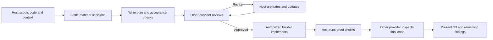

# trident-loop

[](https://github.com/RogerioTrani/trident-loop/actions/workflows/ci.yml) [](LICENSE)

trident-loop is a skill for coding-agent CLIs. You write a plan with the agent you are already talking to, a different provider reviews it and has to back each finding with evidence, a builder you choose implements it, and a fresh session of yet another provider inspects the final diff. It works with six CLIs: Claude Code, Codex, Kimi Code, DeepSeek Harness, qwen-code and OpenCode.

It is adapted from [chaseai-yt/claudex-loop](https://github.com/chaseai-yt/claudex-loop) (MIT), which supports two providers, Claude and Codex.



## Why a different provider

Each model family has its own blind spots, and a review only counts when the reviewer could not have written the plan itself, so the reviewer always comes from another provider. Every run records who planned, reviewed, built and inspected, which model was requested and which one actually answered, and the evidence behind each finding.

## Provider support

| Provider | CLI | Host | Review / Inspect | Build | Boundary | Live verification |
|---|---|---|---|---|---|---|
| Claude | `claude` | yes | yes | yes | safe mode, `Read/Glob/Grep` only | Live-tested (upstream baseline) |
| Codex | `codex` | yes | yes | yes | read-only / workspace-write sandbox | Live-tested (upstream baseline) |
| Kimi | `kimi` | yes | yes | yes | agent-file allowlist + audited stream + path scope | CLI verified; review path not live-tested |
| DeepSeek | `dsh` | best-effort¹ | yes | yes | `DSH_PERMISSION_MODE=read-only` sandbox preset | Not live-tested |
| Qwen | `qwen` | yes | yes | yes | `--safe-mode` + `--exclude-tools` + audited stream | Not live-tested |
| OpenCode | `opencode` | yes | yes | yes | `plan` agent (asks auto-reject) + audited stream | CLI verified; review path not live-tested |

¹ dsh has no native skill directory. To host the loop there, point an `AGENTS.md` at the skill (see below); otherwise use DeepSeek only as reviewer, builder or inspector.

Default roles come from the pipeline order claude → codex → kimi → deepseek → qwen → opencode. The reviewer is the first provider that is not the host, the builder is the host, and the inspector is the first provider that is not the builder. You can override any of them (see "Role dialogue" below).

The runner registers each provider with an explicit boundary profile, and an unknown provider name fails before anything launches. To add another CLI, implement one profile (launch flags, stream parsing, resume semantics) in `skills/trident-loop/scripts/runner.py`.

## Install

The same checkout installs into each CLI through that CLI's own plugin mechanism.

Claude Code, through the plugin marketplace:

```
/plugin marketplace add RogerioTrani/trident-loop
/plugin install trident-loop@trident-loop
```

Kimi Code: open `/plugins`, choose *Custom*, pick install from a GitHub URL and paste this repository's URL. Kimi reads `.kimi-plugin/plugin.json`.

Codex: clone the repository and copy the skill, or use Codex plugin packaging with `.codex-plugin/plugin.json`.

```
git clone https://github.com/RogerioTrani/trident-loop.git
python trident-loop/install.py --host codex        # copies into ~/.agents/skills
```

qwen-code: load the repository as an extension (qwen-code inherits `gemini-extension.json` support from the Gemini CLI), or copy the skill directory yourself.

```
python install.py --host qwen --dir ~/.qwen/skills   # adjust to your skills directory
```

DeepSeek Harness (dsh): to use it as reviewer, builder or inspector, install nothing; authenticate the CLI and select it with `reviewer=deepseek` or `builder=deepseek`. To host the loop in dsh, add an `AGENTS.md` to your project:

```markdown
trident-loop: harden plans with independent review before building.
Read skills/trident-loop/SKILL.md from the trident-loop repository and follow its phases.
```

OpenCode: install the skill into a directory opencode searches (`.opencode/skills`, `~/.config/opencode/skills`, or the Claude/agent-compatible skills directories):

```
python install.py --host opencode        # copies into ~/.config/opencode/skills
```

Any host, by hand: `python install.py --host claude|codex|kimi|qwen|opencode [--dir PATH] [--link]`. The default directories for `claude` (`~/.claude/skills`) and `codex` (`~/.agents/skills`) are verified. The ones for `kimi`, `qwen` and `opencode` are guesses, so for those use the plugin or extension route, or pass `--dir`.

Every provider you delegate to must be installed and signed in. The loop never calls a hosted API itself. The shared runner needs Python 3.10 or newer and has no pip dependencies.

## Usage

Start in any supported host CLI:

```
trident this feature — plan and implement it
trident this plan, mode=review, plan=docs/migration.md, rounds=3
trident this feature, builder=codex, reviewer_model=gpt-6-astra
trident this tax-calculation module, reviewer=qwen, rounds=8
```

`gpt-6-astra` is only an example; pass any model your CLI and account accept.

| Argument | Default | Meaning |
|---|---|---|
| `mode` | `full` | `review` starts from an existing plan |
| `plan` / `log` | `PLAN.md` / `PLAN-REVIEW-LOG.md` | Plan path and append-only decision log |
| `builder` | host | Provider implementing the plan |
| `reviewer` | pipeline default | Chosen per round; swappable between rounds |
| `providers` / `PROVIDER_ORDER` | `claude,codex,kimi,deepseek,qwen,opencode` | Pipeline used to resolve default roles |
| `rounds` / `MAX_ROUNDS` | `5` | Default round budget; user extension is honored and recorded |
| `inspect` | `on` | Final independent inspection; `off` is an explicit, logged opt-out |

### Role dialogue

The host stops to ask at each role decision: the first reviewer, a reviewer swap between rounds, the builder and the inspector. It recommends the pipeline default unless you already gave a standing instruction such as "tax reviews go to qwen" or "always follow the pipeline". You can deviate at any point. The log records each deviation with its reason, and a deviation never becomes the new default on its own. Swapping reviewers starts a fresh session that carries every earlier finding and how it was handled, and the round count keeps going. The final approval is the last reviewer's verdict on the final plan, bound to that plan's hash.

### What an approval means

The runner accepts a review only when the CLI turn completed and the output parses as a structured review with a verdict, findings backed by evidence, coverage and limitations. An empty output file or a session-start event does not count. The approval stores the plan's SHA256, so any later edit to the plan voids it. A `BLOCKED` verdict, a failed process or an exhausted round budget is reported to you and never turned into an approval. A review with zero findings is valid, but it does not prove the plan is correct.

## Development

```
python -m unittest discover -s skills/trident-loop/scripts -t skills/trident-loop/scripts -v
```

The suite runs against fake CLI processes and covers every boundary, audit, resume and failure path without spending model quota. CI runs it on Windows, macOS and Linux. Run live smoke tests only in throwaway fixtures, with an explicit model. Each provider's verification status and boundary details are in `references/runtime.md` inside the skill.

## History and credits

This repository began as a customization of [claudex-loop](https://github.com/chaseai-yt/claudex-loop) (MIT, © Chase AI) that added Kimi Code as a third provider. Later the role model became a provider registry with a boundary profile per provider, and DeepSeek Harness and qwen-code joined. The upstream repository documents its own history (it was previously `grill-me-codex` and then `crucible`). Parts of the runner and the skill text come from claudex-loop and stay under its MIT license and copyright.

`ADR-FORMAT.md` and `CONTEXT-FORMAT.md` are adapted, via claudex-loop, from [Matt Pocock's skills](https://github.com/mattpocock/skills) (MIT, © Matt Pocock). Upstream's legacy interview skills are not included here.

## Security

Review and inspection are read-only. In build mode the builder can edit files and run commands without asking for each action: Codex runs with `approval_policy="never"`, Qwen with `--approval-mode yolo` and OpenCode with `--auto`. trident-loop adds no isolation of its own on top of each CLI's boundary, so build in a repository you can reset and keep production credentials out of the environment. [SECURITY.md](SECURITY.md) covers the trust model and how to report a vulnerability.

## Disclaimer

This project is not affiliated with, endorsed by or sponsored by Anthropic, OpenAI, Moonshot AI, DeepSeek, Alibaba, the Qwen team or the OpenCode project. Product names are trademarks of their owners. You are responsible for the CLIs you install and the code you run, so read each provider's permission boundary in `references/runtime.md` before you delegate work.
