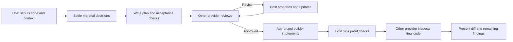

# trident-loop

[](https://github.com/RogerioTrani/trident-loop/actions/workflows/ci.yml) [](LICENSE)

**Harden a plan with independent cross-provider review, then build it and have a different provider inspect the code.** One skill, five coding-agent CLIs: the conversation you are in owns requirements and coordination; a *different* provider challenges the plan with evidence; the selected builder implements; a fresh session of another provider inspects the final diff.

Adapted from [chaseai-yt/claudex-loop](https://github.com/chaseai-yt/claudex-loop) (MIT) and extended from two providers (Claude + Codex) to five.



## Why cross-provider

The reviewer being a *different* provider is the point: each model family has its own blind spots, and a review only counts when the reviewer could not have written the plan itself. Every run records who planned, reviewed, built and inspected, which model was requested versus observed, and what evidence backed each finding.

## Provider support

| Provider | CLI | Host | Review / Inspect | Build | Boundary | Live verification |
|---|---|---|---|---|---|---|
| Claude | `claude` | yes | yes | yes | safe mode, `Read/Glob/Grep` only | Live-tested (upstream baseline) |
| Codex | `codex` | yes | yes | yes | read-only / workspace-write sandbox | Live-tested (upstream baseline) |
| Kimi | `kimi` | yes | yes | yes | agent-file allowlist + audited stream + path scope | CLI verified; review path not live-tested |
| DeepSeek | `dsh` | best-effort¹ | yes | yes | `DSH_PERMISSION_MODE=read-only` sandbox preset | Not live-tested |
| Qwen | `qwen` | yes | yes | yes | `--safe-mode` + `--exclude-tools` + audited stream | Not live-tested |

¹ dsh has no native skill directory: host it by pointing `AGENTS.md` at the skill (see below), or use DeepSeek as reviewer/builder/inspector only.

Default roles resolve from the pipeline order **claude → codex → kimi → deepseek → qwen**: the plan reviewer is the first provider that is not the host, the builder defaults to the host, and the inspector is the first provider that is not the builder. The pipeline is a recommendation, not a rule — see *Role dialogue* below.

Each provider is registered in the runner behind an explicit boundary profile; an unrecognized name fails before anything launches. Adding another CLI means implementing one profile (launch flags, stream parsing, resume semantics) in `skills/trident-loop/scripts/runner.py`.

## Install

The repository is a multi-host plugin: the same checkout installs into each CLI through its native mechanism.

**Claude Code** (plugin marketplace):

```
/plugin marketplace add RogerioTrani/trident-loop
/plugin install trident-loop@trident-loop
```

**Kimi Code**: open `/plugins` → *Custom* → install from a GitHub URL, and pass this repository's URL. Kimi reads `.kimi-plugin/plugin.json`.

**Codex**: clone the repository and copy the skill, or use Codex plugin packaging with `.codex-plugin/plugin.json`:

```
git clone https://github.com/RogerioTrani/trident-loop.git
python trident-loop/install.py --host codex        # copies into ~/.agents/skills
```

**qwen-code**: load the repository as an extension (`gemini-extension.json`, inherited from the Gemini CLI harness), or copy the skill directory manually:

```
python install.py --host qwen --dir ~/.qwen/skills   # adjust to your skills directory
```

**DeepSeek Harness (dsh)**: as a *participant* (reviewer/builder/inspector) dsh needs no install — authenticate the CLI and it is selectable with `reviewer=deepseek` / `builder=deepseek`. To *host* the loop in dsh, add an `AGENTS.md` to your project:

```markdown
trident-loop: harden plans with independent review before building.
Read skills/trident-loop/SKILL.md from the trident-loop repository and follow its phases.
```

**Any host, manual**: `python install.py --host claude|codex|kimi|qwen [--dir PATH] [--link]`. The default directories for `claude` (`~/.claude/skills`) and `codex` (`~/.agents/skills`) are verified; those for `kimi` and `qwen` are best-effort guesses, so prefer the plugin/extension route there or pass `--dir` explicitly.

Every delegated mode needs the other CLIs installed and authenticated; the loop never calls a hosted API directly. Python **3.10+** runs the shared runner; there are no pip dependencies.

## Usage

Start in any supported host CLI:

```
trident this feature — plan and implement it
trident this plan, mode=review, plan=docs/migration.md, rounds=3
trident this feature, builder=codex, reviewer_model=gpt-6-astra
trident this tax-calculation module, reviewer=qwen, rounds=8
```

Model names such as `gpt-6-astra` are examples; pass whatever model your CLI and account accept.

| Argument | Default | Meaning |
|---|---|---|
| `mode` | `full` | `review` starts from an existing plan |
| `plan` / `log` | `PLAN.md` / `PLAN-REVIEW-LOG.md` | Plan path and append-only decision log |
| `builder` | host | Provider implementing the plan |
| `reviewer` | pipeline default | Chosen per round; swappable between rounds |
| `providers` / `PROVIDER_ORDER` | `claude,codex,kimi,deepseek,qwen` | Pipeline used to resolve default roles |
| `rounds` / `MAX_ROUNDS` | `5` | Default round budget; user extension is honored and recorded |
| `inspect` | `on` | Final independent inspection; `off` is an explicit, logged opt-out |

**Role dialogue.** At each role decision — the round-1 reviewer, a reviewer swap between rounds, the builder, the inspector — the host recommends the pipeline default and asks, unless you have already given a standing instruction ("tax reviews go to qwen", "always follow the pipeline"). Deviations are allowed anywhere and recorded in the log with the reason; they never silently become the new default. A reviewer swap starts a fresh session carrying all prior findings and dispositions, never resets the round count, and the final approval binds to the final reviewer's verdict on the final plan hash.

**What an approval means.** The runner validates a completed CLI turn and a structured review (verdict, evidence-backed findings, coverage, limitations); an empty output file or a session-start event is not approval. Approval records the plan's SHA256 — change the plan and it lapses. `BLOCKED`, failed processes and exhausted budgets are surfaced, never converted to approval. Zero findings is valid and is not proof of exhaustive correctness.

## Development and verification

```
python -m unittest discover -s skills/trident-loop/scripts -t skills/trident-loop/scripts -v
```

The suite drives fake CLI processes — every boundary, audit, resume and failure path is covered without spending model quota. CI runs the suite on Windows, macOS and Linux. Live smoke tests belong in disposable fixtures with an explicit model; see `references/runtime.md` in the skill for each provider's verification status and boundary details.

## History and credits

This repository started as a customization of [claudex-loop](https://github.com/chaseai-yt/claudex-loop) (MIT, © Chase AI) that added Kimi Code as a third provider, then generalized the role model into a provider registry with per-provider boundary profiles and added DeepSeek Harness and qwen-code. The upstream lineage (formerly `grill-me-codex` and `crucible`) is documented in its repository. Portions of the runner and skill text derive from claudex-loop and remain MIT-licensed under the original copyright.

`ADR-FORMAT.md` and `CONTEXT-FORMAT.md` are adapted, via claudex-loop, from [Matt Pocock's skills](https://github.com/mattpocock/skills) (MIT, © Matt Pocock). Upstream's legacy interview skills are not part of this repository.

## Security

Review and inspection run read-only, but **build mode lets the builder edit files and run commands without per-action approval** (Codex with `approval_policy="never"`, Qwen with `--approval-mode yolo`). trident-loop adds no isolation beyond each CLI's own boundary. Build in a repository you can reset, without production credentials in the environment. See [SECURITY.md](SECURITY.md) for the full trust model and how to report a vulnerability.

## Disclaimer

Not affiliated with, endorsed by, or sponsored by Anthropic, OpenAI, Moonshot AI, DeepSeek, Alibaba or the Qwen team. All product names are trademarks of their respective owners. You are responsible for the CLIs you install and the code you run; review each provider's permission boundary in `references/runtime.md` before delegating work.
